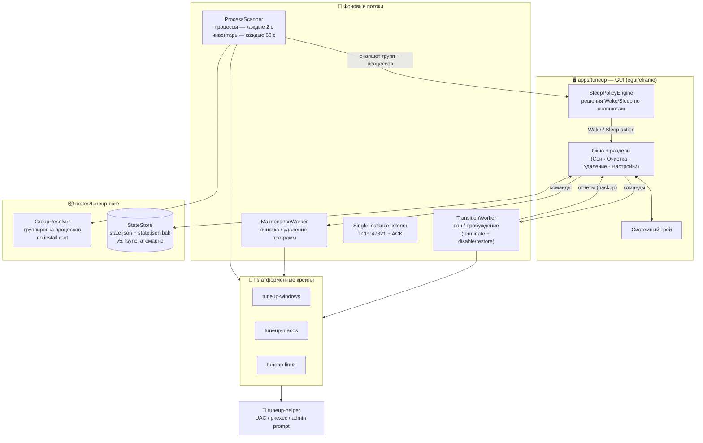
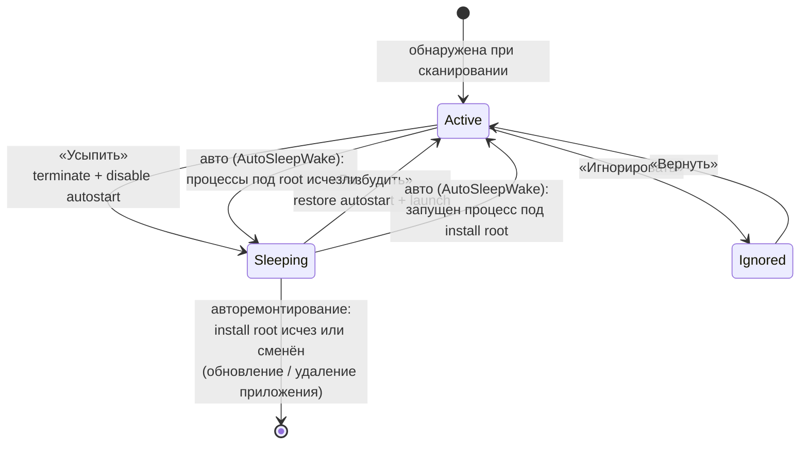
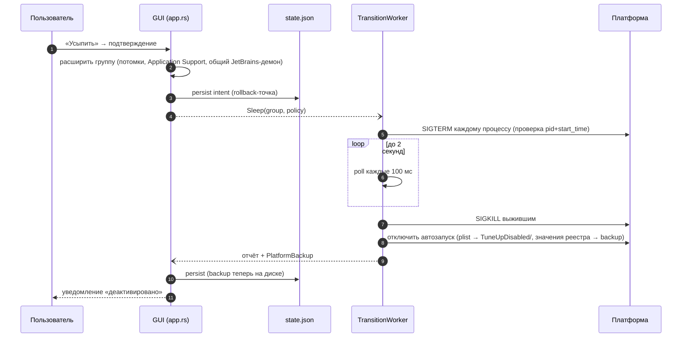
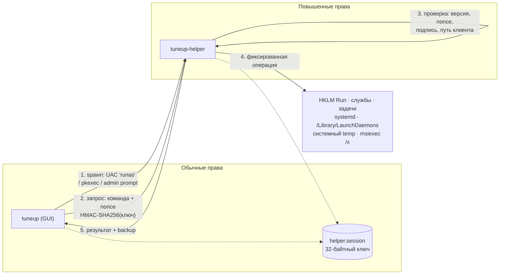
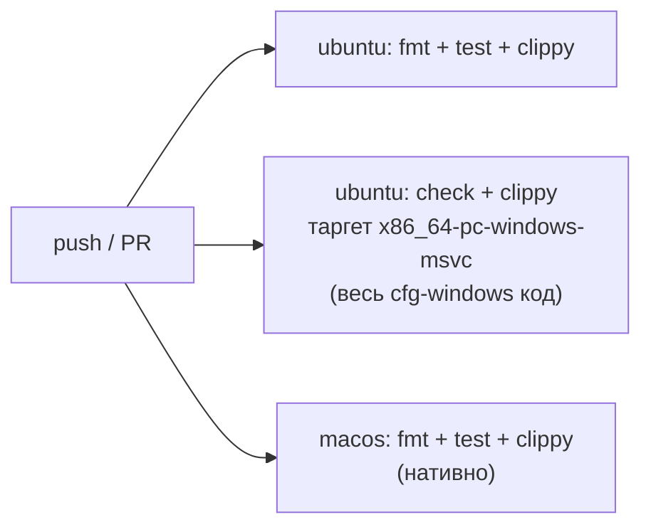

<div align="center">

# 🎛️ TuneUp

**Кроссплатформенный «деактиватор» фоновых приложений для Windows, macOS и Linux**

Усыпляйте прожорливые программы, чистите кэш и временные файлы,
удаляйте приложения вместе с остатками — из одного окна в системном трее.

[](https://github.com/BagmanovIlnar/TuneUp/actions/workflows/ci.yml)
[](https://github.com/BagmanovIlnar/TuneUp/releases)


Версия **0.2.0** · Rust **1.98+** · лицензия **MIT**

</div>

---

## Содержание

1. [Что умеет](#что-умеет)
2. [Как это выглядит](#как-это-выглядит)
3. [Архитектура](#архитектура)
4. [Режим сна (Sleep Mode)](#режим-сна-sleep-mode)
5. [Привилегированный helper и IPC](#привилегированный-helper-и-ipc)
6. [Платформы](#платформы)
7. [Установка](#установка)
8. [Сборка из исходников](#сборка-из-исходников)
9. [Разработка и тесты](#разработка-и-тесты)
10. [Состояние и журналы](#состояние-и-журналы)
11. [Безопасность](#безопасность)
12. [Структура проекта](#структура-проекта)
13. [Типичные проблемы](#типичные-проблемы)
14. [Ограничения и планы](#ограничения-и-планы)

---

## Что умеет

| Возможность | Описание |
|---|---|
| 😴 **Сон приложений** | Мягко завершает процессы группы (`SIGTERM` → 2 c → `SIGKILL`) и отключает автозапуск; пробуждение восстанавливает автозапуск и может сразу запустить приложение |
| 🔗 **Умная группировка** | Связывает процессы, install root (`.app` / каталог установки / `/opt/...`), записи автозапуска, LaunchAgents, systemd units |
| 📊 **Оценка нагрузки** | Балл по CPU, памяти, числу процессов и точек автозапуска |
| 🧹 **Очистка** | Скан безопасных кандидатов (кэш, temp, корзина) с предпросмотром и выбором |
| 🗑️ **Удаление** | Штатный uninstall ОС + выборочные остатки (профили — только явным согласием) |
| ⚙️ **Автозапуск TuneUp** | Регистрация самого себя на вход в систему (Run-ключ / LaunchAgent / XDG) |
| 💾 **Персистентность** | Сон переживает перезапуск TuneUp; state с атомарной записью и backup-поколением |
| 🔔 **Уведомления** | Десктоп-уведомления о переходах сна/пробуждения |
| 🪟 **Tray-first UX** | Живёт в трее; закрытие окна сворачивает в трей, выход — явно через меню |

## Как это выглядит

Приложение живёт в **системном трее**. Главное окно открывается кликом по иконке
или пунктом **«Открыть»**, закрывается обратно в трей. Боковое меню — четыре раздела:

| Раздел | Назначение |
|---|---|
| **Сон** | Список приложений с фильтрами и поиском, усыпление / пробуждение, детали процессов |
| **Очистка** | Скан безопасных кандидатов → выбор категорий → удаление |
| **Удаление** | Установленные программы → остатки → uninstall |
| **Настройки** | Автозапуск TuneUp, полный сброс состояния |

Список процессов обновляется каждые **2 секунды**; метрики CPU/RAM в интерфейсе —
каждые 10 секунд или при изменении состава приложений.

---

## Архитектура

### Общая схема



### Ключевые решения

- **Всё тяжёлое — вне UI-потока.** Сканер, переходы сна и операции очистки/удаления
  работают в отдельных потоках и общаются с GUI через каналы событий; интерфейс
  не блокируется даже при ожидании admin-пароля или graceful-завершении процессов.
- **Сон — это terminate + disable, а не freeze.** Замороженный процесс продолжает
  держать память; TuneUp завершает процессы (мягко) и убирает точки автозапуска.
- **State — источник истины.** `PlatformBackup` (данные отката автозапуска)
  существует только в `state.json`, поэтому запись атомарная, с `fsync`, и
  предыдущее поколение всегда сохраняется в `.bak`.
- **Платформа — за трейтами.** `tuneup-platform` описывает возможности
  (`InventoryProvider`, `ProcessControl`, `PlatformMutator`, `CleanupProvider`,
  `UninstallProvider`, `SelfAutostartProvider`), GUI о платформе не знает.

---

## Режим сна (Sleep Mode)

### Жизненный цикл группы



> Группы `Ignored` автоматика не трогает. Сон **переживает перезапуск TuneUp**:
> при старте TuneUp повторно завершит вернувшиеся процессы спящих групп.

### Последовательность усыпления



### Пробуждение и автоматика

| Событие | Действие |
|---|---|
| Нажатие **«Разбудить»** | Восстановить автозапуск из backup **и запустить** приложение |
| Появился процесс **внутри install root** спящей группы (Auto) | Восстановить автозапуск без запуска + уведомление |
| Не осталось процессов под install root (Auto) | Повторно усыпить: завершить связанные (включая хелперы вне root) + отключить |
| Install root группы исчез/сменён (обновление, удаление приложения) | **Авторемонтирование**: восстановить автозапуск, снять группу с учёта |
| Выход из TuneUp | Спящие группы остаются усыплёнными; TuneUp дожидается незавершённых переходов |

«Приложение запущено» определяется по путям **под install root** (например,
`RustRover.app`). Общий демон вроде `jetbrainsd` вне бандла не держит группу
активной, но при усыплении завершается как связанный процесс.

---

## Привилегированный helper и IPC

Пользовательские операции (XDG, LaunchAgents пользователя, SIGTERM своих
процессов) выполняются без прав. Системные — через helper по фиксированному
протоколу:



**Защита:**
- фиксированный набор команд — произвольного shell и путей нет;
- каждый запрос подписан HMAC-SHA256 с монотонным nonce (защита от replay);
- named pipe с DACL (текущий пользователь / SYSTEM / администраторы),
  проверка образа клиента (`tuneup.exe` в том же каталоге);
- на Linux — `pkexec` + Polkit policy, payload через stdin без shell;
- после последнего запроса helper завершается (Windows — до 5 минут idle);
- ключ хранится только в профиле пользователя, в логи не пишется.

---

## Платформы

| | Windows 10/11 | macOS | Linux |
|---|:---:|:---:|:---:|
| GUI + трей | Да | Да (menu bar) | Да (SNI/D-Bus) |
| Сон / Пробуждение | Да | Да | Да |
| Graceful terminate | `TerminateProcess` | `SIGTERM` → `SIGKILL` | `SIGTERM` → `SIGKILL` |
| Очистка | Да (+ helper) | Да | Да |
| Удаление | Win32/MSI/Store* | `.app` / Homebrew Cask | DEB/RPM/Flatpak/Snap |
| Автозапуск приложений | Run, Startup, Tasks, Services | LaunchAgents/Daemons, Login Items | XDG, systemd |
| Привилегии | UAC + `tuneup-helper` | admin dialog (osascript) | `pkexec` / Polkit |

\* Store — при наличии штатного идентификатора удаления.
Современные macOS Background Items без публичного API Apple только отображаются.

---

## Установка

### Готовые пакеты (Release)

Релизы собираются по git-тегу `vX.Y.Z` и публикуются в
[GitHub Releases](https://github.com/BagmanovIlnar/TuneUp/releases):

| Артефакт | Платформа |
|---|---|
| `tuneup-X.Y.Z-macos.zip` | macOS — `TuneUp.app` |
| `tuneup-X.Y.Z-windows-x64.zip` | Windows — `tuneup.exe` + `tuneup-helper.exe` |
| `tuneup-X.Y.Z-linux-x64.tar.gz` | Linux — бинарники |
| `tuneup_X.Y.Z_amd64.deb` / `tuneup-X.Y.Z-1.x86_64.rpm` | Linux — пакеты (включая Polkit policy) |

```bash
# Linux (.deb)
sudo dpkg -i tuneup_1.0.0_amd64.deb
# Linux (.rpm)
sudo rpm -Uvh tuneup-1.0.0-1.x86_64.rpm
```

> **Windows:** держите `tuneup-helper.exe` в одном каталоге с `tuneup.exe`.

### Быстрый старт на Ubuntu (из исходников)

```bash
sudo apt update
sudo apt install -y build-essential pkg-config curl git polkitd pkexec systemd

curl -proto '=https' --tlsv1.2 -sSf https://sh.rustup.rs | sh
source "$HOME/.cargo/env"
rustup toolchain install 1.98.1

git clone git@github.com:BagmanovIlnar/TuneUp.git tuneup
cd tuneup
rustup override set 1.98.1

cargo build -p tuneup -p tuneup-helper
cargo run -p tuneup
```

После старта окно **скрыто** — откройте его кликом по иконке в трее.
Хелпер вручную не запускайте: GUI поднимет его через `pkexec` при необходимости.

Требования к десктопу: X11 или Wayland **с SNI-хостом** (GNOME + расширение
AppIndicator, KDE, Cosmic); на Wayland окно работает через XWayland (`DISPLAY`).

## Сборка из исходников

```bash
# Debug / Release
cargo build -p tuneup            # + -p tuneup-helper на Windows/Linux

# macOS: пакет .app без окна Terminal
./scripts/macos/package-app.sh

# Linux: .deb / .rpm / tar.gz (локально)
TUNEUP_VERSION=1.0.0 ./scripts/ci/package-linux.sh

# Кросс-проверка типов под Windows (с любой ОС)
rustup target add x86_64-pc-windows-msvc
cargo check --workspace --all-targets --target x86_64-pc-windows-msvc
```

Полноценный Windows-бинарник и UAC-манифест хелпера — только на Windows-хосте
(нужен `rc.exe` из VS Build Tools).

Подробные логи: `TUNEUP_LOG=debug cargo run -p tuneup`.

## Разработка и тесты

```bash
cargo fmt --all --check                 # форматирование
cargo test --workspace                  # unit-тесты (84+)
cargo clippy --workspace --all-targets -- -D warnings
```

CI (push/PR) проверяет **три платформы**:



Интеграционные тесты платформ меняют реальную систему (реестр, LaunchAgents,
systemd) и помечены `#[ignore]` — запускать только в изолированной VM:

```bash
cargo test -p tuneup-macos  -- --ignored --nocapture
cargo test -p tuneup-linux  -- --ignored --nocapture
# Windows (PowerShell):
cargo test -p tuneup-windows --test windows_integration -- --ignored --nocapture
```

Релиз: тег `vX.Y.Z` → workflow Release соберёт все артефакты и опубликует
GitHub Release.

---

## Состояние и журналы

| ОС | State | Логи |
|---|---|---|
| Windows | `%LOCALAPPDATA%\TuneUp\state.json` (+ `.bak`) | `%LOCALAPPDATA%\TuneUp\logs\tuneup.log.YYYY-MM-DD` |
| macOS | `~/Library/Application Support/TuneUp/state.json` (+ `.bak`) | `~/Library/Logs/TuneUp/logs/...` |
| Linux | `$XDG_STATE_HOME/TuneUp/state.json` (+ `.bak`) | `$XDG_STATE_HOME/TuneUp/logs/...`, `/var/log/TuneUp/helper.log.*` |

- Формат state: JSON, версия **5**; миграции со v1/v2+; при повреждении
  основного файла загружается `.bak` (предыдущее поколение, обновляется при
  каждой успешной записи).
- Запись атомарная (tmp → rename) с `fsync` файла и каталога.
- Перед ручным удалением state завершите TuneUp через трей.

## Безопасность

- GUI работает **без** повышенных прав; UAC / admin dialog / Polkit — только
  для системных объектов, по требованию.
- Denylist критических процессов (`launchd`, `windowserver`, `systemd`,
  `explorer`, …) + защита системных путей исполняемых файлов.
- Перед каждым сигналом сверяется `(pid, start_time)` — реюз PID не убьёт
  чужой процесс.
- Отключение автозапуска только при **точном** совпадении цели с install root;
  startup-файлы переносятся в `TuneUpDisabled/`, а не удаляются.
- Завершение процессов мягкое: `SIGTERM` → 2 c → `SIGKILL` (macOS/Linux).
- Cleanup/uninstall удаляют только пути, повторно валидируемые по allowlist
  и protected-roots; профили и настройки — только с явного согласия.

> **Не усыпляйте** системную оболочку, антивирус, драйверы и критичные сервисы.

## Структура проекта

```
tuneup/
├── apps/
│   ├── tuneup/                  # GUI: egui, трей, scanner, transitions, maintenance
│   │   └── src/
│   │       ├── app.rs           # состояние UI, политика, обработка событий
│   │       ├── scanner.rs       # фоновый сканер процессов и инвентаря
│   │       ├── transition_worker.rs  # сон/пробуждение вне UI-потока
│   │       ├── maintenance_worker.rs # очистка/удаление вне UI-потока
│   │       ├── deactivator.rs   # DeactivationManager: terminate + disable/restore
│   │       ├── single_instance.rs    # TCP :47821 + ACK-протокол
│   │       └── views/           # cleanup / uninstall / settings
│   └── tuneup-helper/           # привилегированный helper (Windows, Linux)
├── crates/
│   ├── tuneup-core/             # модели, grouping, policy, state v5, IPC-протокол
│   ├── tuneup-platform/         # трейты платформенных возможностей
│   ├── tuneup-windows/          # реестр, задачи, службы, named pipe, TerminateProcess
│   ├── tuneup-macos/            # .app, launchd, Login Items, нативный plist, open
│   └── tuneup-linux/            # пакеты, XDG, systemd, /proc-identity
├── packaging/                   # .desktop, Polkit policy, nfpm-шаблон
├── scripts/                     # packaging, версия workspace
└── .github/workflows/           # CI (3 платформы), Release по тегам
```

## Типичные проблемы

| Симптом | Что делать |
|---|---|
| Нет окна после запуска | Так задумано: откройте иконку в трее / «Открыть» |
| Нет иконки в трее (GNOME) | Нужен SNI-хост — расширение «AppIndicator and KStatusNotifierItem» |
| Окно не прячется в трей (Wayland) | Нужен `DISPLAY` (XWayland) — приложение само форсит X11; проверьте `echo $DISPLAY` |
| После сна остался «Running in Background» | Включите авто-режим: после закрытия IDE группа усыпится повторно и добьёт хелперы |
| Повторный запуск не будит группу | Без галочки «авто» ручной запуск не отслеживается — нажмите **Разбудить** |
| Группа «залипла» в Sleeping после обновления приложения | При следующем старте TuneUp авторемонтирует её (восстановит автозапуск); или «Сбросить всё» |
| Helper не найден (Windows) | Положите `tuneup-helper.exe` рядом с `tuneup.exe` |
| Manifest helper без UAC | Собирайте helper на Windows-хосте |
| Порт 47821 занят другим приложением | TuneUp запустится без защиты от двойного запуска (warning в логе) |
| `policykit-1 has no installation candidate` | Ubuntu 24.04+: ставьте `polkitd pkexec` |
| `Could not get lock ... apt` | Дождитесь другого `apt`; lock не удалять |
| Запрос пароля админа | Нормально (`pkexec` / UAC / osascript); отмена → откат операции |
| Нужен разбор бага | `TUNEUP_LOG=debug` и смотрите лог за день |

## Ограничения и планы

**Сейчас:**
- Политика сна — опрос каждые 2 c (реакция не мгновенная).
- Windows-terminate без graceful-фазы (`WM_CLOSE` не реализован).
- macOS Background Items (SMAppService) — только отображение.
- Installer, notarization и auto-update отсутствуют.

**В планах:** событийный мониторинг процессов, graceful-завершение на Windows,
инсталляторы, автообновление.

---

## Лицензия

MIT — см. [LICENSE](LICENSE).
